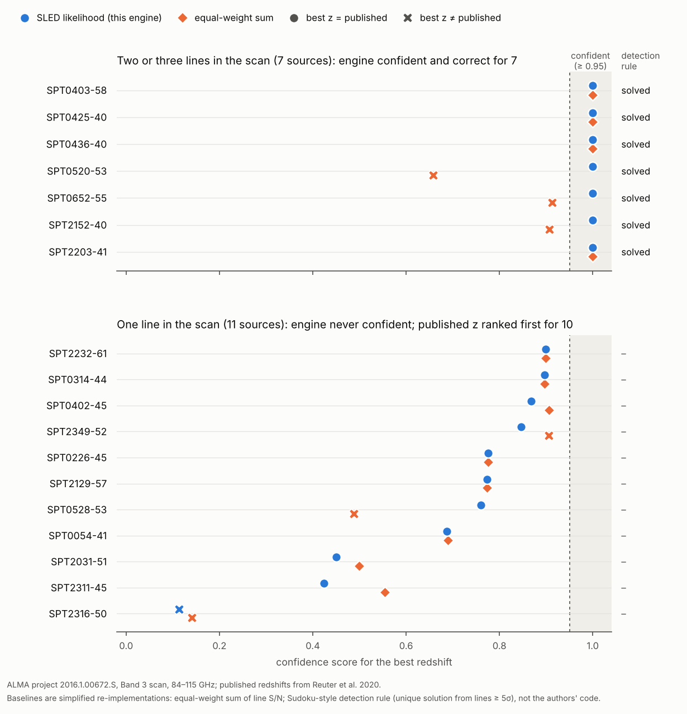
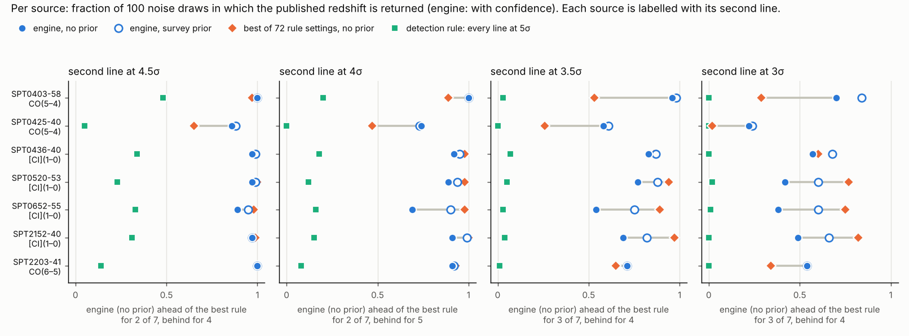
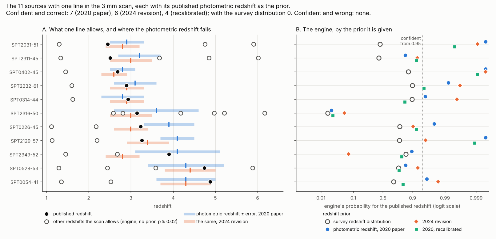

# ladder-redshifts

Redshifts of dusty galaxies from their molecular line ladders, treated as **missing-fundamental pitch estimation**.

A spectral scan of a distant galaxy usually shows one to three lines of the carbon monoxide (CO) ladder. Like a few
harmonics of a note whose fundamental is missing, they can fit several "pitches". The wrong answers are octave
errors, and they have caught out published redshifts. This repository contains a likelihood engine that weighs every
line it predicts, including lines that should be visible but are not. With every answer it gives a confidence
score, so on a spectrum that cannot decide it can say "ambiguous" and list the competing redshifts. It is tested on
real ALMA spectra. This is exploratory work and not yet peer-reviewed; see [Limitations](#limitations).



## Result on real ALMA data

The engine was run on 18 dusty star-forming galaxies from the South Pole Telescope (SPT) sample. The data are
ALMA project 2016.1.00672.S, a Band 3 scan covering 84–115 GHz. Spectra come from cut-outs of the archive's pipeline
cubes, and each answer is scored against the published redshift (Reuter et al. 2020):

| Sources | This engine | Equal-weight sum | Detection rule (simplified Sudoku) |
|---|---|---|---|
| 7 with two or three lines in the scan | **7** confident and correct | 4 | 7 |
| 11 with one line in the scan | **0** confident; all "ambiguous", with the published z ranked first in 10 | 0 confident | 0 solved |
| Confidently wrong | **0** | 0 | 0 |

"Confident" means a confidence score of at least 0.95: that share of the normalised likelihood × prior lies within
±0.006 in ln(1+z) of the best redshift. The comparison methods are simplified re-implementations (see
[Limitations](#limitations)).

- **The engine and the detection rule agree on the multi-line sources.** Both recover all seven published
  redshifts. The rule needs every line above 5σ, and the faintest second lines here are at 5.6σ (SPT2203-41) and
  6.5σ (SPT0520-53), so as observed these spectra do not test the engine where it should gain, below that
  threshold. An earlier version of this table had the rule at 4 of 7; the extracted noise was about 1.3 times too
  high, which put three of those lines under its threshold
  ([`docs/development-notes.md`](docs/development-notes.md), item 20).
- **Below that threshold, like for like, the engine gives somewhat more answers.** Noise was added to the seven
  spectra until the second line sat at a chosen strength, and every method was given the spectrum alone, with no
  redshift prior ([`docs/results.md`](docs/results.md), section 9).
  - **Against a rule that works as an observer would.** The rule takes the 5σ lines, then accepts one 3σ line at
    a predicted position. With the second line at 4σ the engine returns the published redshift with confidence
    in 87% of noise draws and the rule in 80%; at 3.5σ, 73% and 60%. A form of the rule that does not count a
    missing \[CI\] line against a redshift does a little better (82% and 62%). A rule that needs every line at
    5σ manages 13% and 3%.
  - **The gain is uneven.** At 4σ the engine is ahead for three of the seven sources and behind for four; at
    3.5σ, ahead for four and behind for three (figure below). It gains where the second line is a CO line and
    not where it is a faint \[CI\] line.
  - **Wrong answers are equally rare.** The engine and the rule each returned a different redshift in 4 of
    5,600 draws.
  - **Against a template cross-correlation.** The engine's best guess is the published redshift in 100% of draws
    at 4σ and 98% at 3.5σ; the best guess of a cross-correlation after Yun et al. (2015), in 96% and 92%.
  - **With the survey's redshift distribution as a prior** the engine's figures rise to 92% at 4σ and 80% at
    3.5σ. The rule, as built, gains nothing from the same prior.
  - **What this is not.** These are the spectra the engine was developed on, with simulated extra noise, and the
    rule and the cross-correlation are our own constructions. It is not a test on unseen data, and it does not
    show the engine doing better than a practised observer.

  
- **The High-z Sudoku code agrees on which sources can be settled.** The authors' own code, run on the same
  frequency coverage at the published redshifts, classes as robust every source the engine settles, provided
  \[CI\] is counted. That code reads no spectrum, so this checks which redshifts are solvable, not error rates
  ([`docs/results.md`](docs/results.md), section 8).
- **An equal-weight sum falls short here.** It prefers a wrong redshift for three of the two-line sources, with
  0.66–0.91 of its weight on it. In each case it reads CO(4–3) as CO(3–2) or CO(5–4) and treats the \[CI\](1–0)
  line as noise.
- **With the survey prior alone, single-line sources stay ambiguous, as they should.** All eleven have been
  confirmed by follow-up in other bands, which the engine never saw: ten in Reuter et al., and SPT0314-44,
  tentative there, by Riechers (2025). For each source the engine lists the competing redshifts with their
  weights, and a follow-up planner (`followup.py`) names the tunings that would decide between them.
- **With each source's published photometric redshift as the prior, the engine settles four to seven of the
  eleven, all correctly.** The survey team had a photometric redshift for every source (Reuter et al. 2020,
  Table F.1). Used as a Gaussian prior, source by source ([`docs/results.md`](docs/results.md), section 10):
  - **How many depends on which values are believed.** Seven with the 2020 values as published, six with the
    collaboration's 2024 revision, and four when the 2020 values are recalibrated against 60 other SPT sources.
    The engine is confident of a wrong redshift in none of the three.
  - **Rules given the same photometric redshifts settle about as many, with some wrong answers.** Two rules,
    each in two forms, settle two to seven of the eleven. Five of the ten combinations of rule and prior return
    at least one wrong redshift.
  - **One revised value shows the limit.** The 2024 photometric redshift of SPT2349-52 is 2.8 errors from the
    published redshift and sits on the wrong reading of its line. Every rule then answers wrongly, and the
    engine gives that wrong redshift 0.93, just under its threshold of 0.95.
  - **With noise added to the multi-line spectra** the engine with the photometric prior returns the published
    redshift with confidence in 95% of draws with the second line at 4σ and 89% at 3.5σ. A guided rule with the
    same prior, counting CO lines only, manages 84% and 69%. Each gave a wrong answer in fewer than 10 of 5,600
    draws.
  - **What this is not.** Eleven sources, from the development sample; a difference of one or two sources
    between methods shows nothing. The photometric redshifts rest on a dust-temperature prior measured on the
    same sample.

  
- **Second real test.** For SPT0027-50 (ALMA Band 2 science verification, 76.9–111.0 GHz) the engine gives
  z = 3.4432 at confidence 1.00 (published 3.444).
- **Prior check.** With a flat redshift prior in place of the SPT-like one, all 7 multi-line sources are still
  confident and correct. The published z is then ranked first for 8 of the 11 single-line sources, and none is
  confident (maximum 0.66).

All of these numbers are regenerated by the code here. [`docs/results.md`](docs/results.md) has the per-source
tables and the synthetic studies.

## The idea

The CO ladder is a nearly harmonic series: ν_J ≈ J × 115.271 GHz. Redshift divides every frequency by 1+z, so the
observed lines are harmonics of a fundamental 115.271/(1+z) GHz that is never observed. Two lines with frequency
ratio b/a fit the rung pairs (ka, kb) for every k = 1, 2, 3, …. That gives candidate redshifts 1+z_k = k(1+z_1),
an overtone series in 1+z. Pitch trackers are prone to octave errors for the same reason. Three published examples:

- SPT0452-50: first published at z = 2.011, actually z = 5.016 (Riechers 2025).
- SPT0551-50: first published at z = 2.123, actually z = 3.164 (Strandet et al. 2016).
- HerBS-108: two lines that fit z = 3.717 or its lower octave until a third line decided it (Cox et al. 2023).
  The line frequencies put the lower reading at z = 1.36; the paper quotes 1.25.

Three things break the tie: rungs that a hypothesis predicts inside the coverage but that are absent; off-ladder
lines ([CI]) at their own ratios; and the expected relative line strengths (the ladder's "timbre").

The engine puts these in one likelihood:

1. **Matched filter.** The spectrum is matched-filtered on a log-frequency grid of 50 km/s pixels, using only the
   observed channels. Overlapping windows are combined by inverse-variance weighting.
2. **Combining lines.** At each trial redshift, the S/N at every predicted CO and [CI] line is combined,
   weighted by the line's expected brightness and the local noise:
   T = Σ wᵢ yᵢ / √(wᵀ C w). C accounts for overlapping filters at close lines. Each line may sit up to
   150 km/s from its predicted position, so that velocity offsets between lines, and the ladder's slight
   anharmonicity, do not decide between readings.
3. **Averaging.** The likelihood (maximised over the overall line amplitude) is averaged over excitation templates
   and line widths, then multiplied by a redshift prior and normalised over redshift.
4. **Confidence.** The confidence score is the share of that distribution around the best redshift.

Lines that are predicted but absent lower the likelihood automatically. [`docs/method.md`](docs/method.md) gives
the derivation.

**Listen.** [`audio/herbs108_octave_ambiguity.wav`](audio/herbs108_octave_ambiguity.wav) maps HerBS-108's two
lines to 440 and 660 Hz, and plays four sounds in turn:

1. The two lines alone.
2. A full tone on 220 Hz, the pitch the two lines imply (the z = 1.36 reading).
3. A full tone on 110 Hz (the z = 3.72 reading).
4. The two lines with the third, decisive line at 330 Hz. The implied pitch drops an octave to 110 Hz, which is how
   the redshift was resolved.

## Quick start

Requires Python ≥ 3.9 with numpy, scipy and matplotlib (astropy too for the archive scripts). Tested with Python 3.9
(numpy 2.0, matplotlib 3.9) and Python 3.13 (numpy 2.5, matplotlib 3.11).

```bash
python -m pip install -r requirements.txt
python -m pytest                 # 32 regression tests, synthetic and real, under a minute
bash reproduce.sh                # every real-data result and every figure from the shipped spectra, 1-2 min
bash reproduce.sh --full         # also re-run the synthetic studies (about 1.7 hours on 2 cores)
```

Run everything from the repository root. If the package is installed elsewhere (`pip install .`), set
`LADDER_REDSHIFTS_ROOT` to the checkout.

Random seeds are fixed, so the outputs are deterministic. With the library versions used here, a clean run leaves
`git status` unchanged. With other versions, expect only last-digit floating-point differences and re-rendered
figures.

To run the engine on one spectrum:

```python
from ladder_redshifts.batch_real import read_spectrum, to_grid_auto
from ladder_redshifts.realspec import run_engine
from ladder_redshifts.ladder import prior_spt

spec = read_spectrum('data/spectra/SPT0314-44.csv')      # one line, at 87.92 GHz
r = run_engine(*to_grid_auto(spec), prior=prior_spt)
print(r['sled'])           # best z and its confidence: (2.933, 0.897), so ambiguous
print(r['candidates'])     # [(2.933, 0.897), (1.622, 0.103)]: the line is CO(3-2) or CO(2-1)
```

The engine can read any spectrum in the same CSV format: `spw,freq_ghz,flux_mjy,noise_mjy,continuum_mjy`, one row
per channel, with continuum-subtracted flux and per-channel noise. The noise has to be on the right scale: in
line-free channels flux/noise should scatter by 1, and `batch_real` says so when it does not. Channels should be
about 50 km/s wide. Wider channels get an approximate noise correction with a warning, and narrower ones should be
binned first. More detail is in [`data/README.md`](data/README.md).

## Rebuilding the spectra from the ALMA archive

The shipped spectra (`data/spectra/`) were extracted from cut-outs of the archive's pipeline cubes. The cut-outs come
from ALMA's SODA cut-out service, 3.9 GB for all 21 sources instead of 26 GB of whole cubes. To rebuild them:

```bash
bash scripts/alma/get_cutouts.sh --test      # one cut-out, checks that the service answers (< 1 min)
bash scripts/alma/get_cutouts.sh             # 435 files into alma_cutouts/ (ignored by git)
python scripts/alma/extract_cube_spectra.py alma_cutouts --out data --box 8 --tag freq \
       --targets data/cutouts/2016.1.00672.S_targets.csv
python -m ladder_redshifts.batch_real        # point-source spectrum at each published position, then scoring
```

The faster but weaker route through the archive's ADMIT summaries is described in [`data/README.md`](data/README.md),
along with the SPT0027-50 science-verification data.

## Repository layout

```
ladder_redshifts/        the package (run modules with  python -m ladder_redshifts.<module>)
  ladder.py              engine: line catalogue, log-frequency grid, simulator, matched filter, estimators
  realspec.py            spectra from cube cut-outs; the SPT0027-50 Band 2 analysis
  batch_real.py          score every real spectrum under data/ against data/truth.csv
  degrade.py             the multi-line spectra with noise added: the engine against two detection rules
                         and a template cross-correlation
  photoz.py              each source's published photometric redshift as its prior
  followup.py            which single follow-up tuning settles an ambiguous source
  atlas.py               synthetic error-rate atlas, 2,500 sources x 6 ALMA setups
  traps.py               three published octave-type misidentifications, rebuilt from their coverage
  tuning.py              tuning optimiser for ALMA Band 2, now and after the Wideband Sensitivity Upgrade
  ambiguity.py           the undertone family of candidate redshifts, the ambiguity function, the sonification
  summary.py             the headline figure above
scripts/alma/            download and extraction tools for the ALMA archive (cut-outs and ADMIT summaries)
scripts/                 one-off checks: the first review's diagnostics, the truth-table check, the noise
                         calibration of the shipped spectra, the engine on pure noise, the High-z Sudoku code
                         on the same sources (needs your own copy of that code), the photometric-redshift
                         table and its accuracy (needs the SPT collaboration's posted tables)
data/                    published redshifts, extracted spectra, cut-out targets and manifest (see data/README.md)
results/                 every number reported, as JSON/CSV (see results/README.md)
figures/                 every figure (see figures/README.md)
audio/                   the sonification
docs/                    method, results, development notes
tests/                   regression tests
```

## Limitations

- **The confidence is a score, not a calibrated probability.** It is built from a likelihood that is maximised over
  the overall line amplitude. The real data and the simulations disagree about its reliability:
  - **Real data.** On the 11 real single-line sources it is cautious: the stated values average 0.68, but the top
    candidate is the published redshift in 10 of 11.
  - **Simulated scans.** Confident answers (≥ 0.95) are right in 99.4–99.9% of cases, while the stated values
    average 0.999.
  - **A single simulated Band 3 tuning.** 2 of 93 confident answers are wrong.
  - **Pure noise.** On 600 simulated Band 3 scans without any line (SPT-like prior), the confidence exceeded 0.5
    in 5% and never reached 0.95. On Band 3 + Band 4 scans it exceeded 0.5 in 12% and reached 0.95 in 3 of the 600.

  Use 0.95 as a conservative threshold for multi-tuning scans, not as a 95% probability. Calibrating the score needs
  a larger independent sample. Details are in [`docs/results.md`](docs/results.md), section 5.
- **Readings with the same line positions.** When two readings predict lines at the same frequencies (an octave
  pair whose distinguishing rungs are all outside the coverage), only the prior and the line ratios separate them.
  The engine then trusts the ratios more than it should: the excitation prior is a coarse grid, and line fluxes
  are taken as known to the noise level. For bright lines its confidence between such readings is not reliable
  ([`docs/development-notes.md`](docs/development-notes.md), "Known open issues").
- **Small real sample.** The real-data test covers 18 sources from one ALMA programme in one band, plus SPT0027-50.
  These were also the spectra on which the method's bugs were found and fixed
  ([`docs/development-notes.md`](docs/development-notes.md)), so they are a development sample, not a blind test.
  About 100 new sources across several surveys, run with a frozen version, would test the score properly.
  Tag `v0.1.0` is that frozen version: the 0.95 threshold, the ±0.006 window, the line list and the template
  priors are the ones it contains.
- **Where the truth comes from.** For the 7 multi-line sources the published redshifts came from these same 3 mm
  spectra. Agreement there shows that the engine reaches the published answer automatically; it is not an
  independent confirmation. For the 11 single-line sources the truth came from follow-up in other bands that the
  engine never saw.
- **The prior.** The SPT-like redshift prior, N(3.9, 1.1), comes from the same survey. The flat-prior results above
  show how much depends on it. The photometric redshifts are also the survey's own: they rest on a
  dust-temperature prior measured on this sample with its spectroscopic redshifts, and the 2020 values run high
  by about half their error bar.
- **The comparisons are our own simplified re-implementations.**
  - **Equal-weight sum.** It weights every predicted line's S/N equally. That is in the spirit of the line sums of
    Lupu et al. (2012), but their procedure uses further statistics and tests.
  - **Detection rule.** It is a simplified version of High-z Sudoku (Bakx & Dannerbauer 2022), not the authors' code
    ([tjlcbakx/redshift-search-graphs](https://github.com/tjlcbakx/redshift-search-graphs)). That code classes
    frequency coverage and reads no spectrum. Its classes for these sources and for the atlas setups are in
    [`docs/results.md`](docs/results.md), section 8; the authors' reading of the spectra by eye is not reproduced.
  - **Guided rule.** The rule that accepts a weaker line at a predicted position is our own construction. So is
    the window rule of section 10, which borrows only the photometric accuracy that the Sudoku code assumes.
  - **Cross-correlation.** It is our re-implementation of the closest earlier method (Yun et al. 2015), from the
    paper's description: the weights are fitted to the composite of Spilker et al. (2014), the line width is our
    choice, and the paper's photometric redshifts came from a radio-to-millimetre spectral index, not from the
    dust continuum as here ([`docs/results.md`](docs/results.md), sections 9 and 10). The authors' code has not
    been run.

  A comparison with the published methods themselves on these spectra is the obvious next test.
- **Spectrum extraction and noise model.**
  - **Point-source spectra.** Each spectrum is taken at the published position, so extended or multiply-imaged
    sources lose some flux. SPT0027-50 used an aperture instead.
  - **Channel width.** The engine assumes channels of about 50 km/s that are independent after regridding. Other
    channel widths get only an approximate correction.
  - **Noise scale.** The per-channel noise of the cube-route spectra is set from each spectrum's own line-free
    channels, because the extractor's value is too high at the source
    ([`docs/method.md`](docs/method.md), section 7).
  - **What the model leaves out.** Velocity offsets between lines beyond 150 km/s, non-Gaussian line shapes,
    continuum residuals, and lines of other species. Such lines are real: Reuter et al. (2020) report 29 weaker
    features of HCN, HCO⁺, H₂O, ¹³CO and CN in the SPT spectra, and it was H₂O and OH⁺, not CO, that settled
    SPT0314-44 ([`docs/results.md`](docs/results.md), section 4).
- **Synthetic studies.** The parameters of the synthetic population (excitation, \[CI\] strength, line widths) are
  illustrative. The simulated sources are drawn from the same family of models that the engine fits (the same
  ladder shape, Gaussian lines, independent Gaussian noise), so their error rates show how the engine behaves
  when its model holds. Error rates on real spectra can be higher.
- **Review status.** Two automated reviews found problems in the code and data, now fixed: four on 2 November
  ([`docs/review-response.md`](docs/review-response.md)) and eight more on 12 November, among them a noise scale
  that changed the comparison above ([`docs/development-notes.md`](docs/development-notes.md), items 20–27). What
  the second review left open is listed under "Known open issues" there: chiefly the comparisons with the
  published methods and the weight the engine gives to line ratios. None of this is peer-reviewed yet.

## Related work

- Yun, Heyer & Aretxaga 2007, ASP Conf. Ser. 375, 174, and Yun et al. 2015, MNRAS
  (doi:10.1093/mnras/stv1963; arXiv:1508.05425), appendix A: redshifts from Redshift Search Receiver spectra on
  the Large Millimeter Telescope, by cross-correlating the spectrum with a template of many transitions weighted
  by their relative strengths in a composite spectrum, with the significance set by shuffling the spectrum and
  the result multiplied by a photometric-redshift probability. This is the closest earlier method. For a single
  template, the statistic T used here is that cross-correlation with an analytic normalisation; this engine adds
  a bank of templates with a prior, a posterior with a confidence score, and the velocity tolerance
  ([`docs/method.md`](docs/method.md), section 3). A re-implementation is compared with the engine in
  [`docs/results.md`](docs/results.md), section 9; the authors' own code has not been run.
- Spilker et al. 2014, ApJ 785, 149 (arXiv:1403.1667): the composite spectrum of SPT galaxies. Its line
  luminosities (Table 2) set the weights of the cross-correlation re-implemented here.
- Lupu et al. 2012, ApJ 757, 135: Z-Spec redshift search, combining the S/N of the predicted lines at each trial
  redshift (several statistics, including total-flux and pairwise S/N sums).
- Bakx & Dannerbauer 2022, MNRAS 515, 678 (arXiv:2204.06011): High-z Sudoku; robustness of redshift solutions and
  tuning optimisation. Bakx 2026 (arXiv:2604.01089) applies that tool to scan strategies for Band 3 and for
  Band 2 with wider bandwidths, the question `tuning.py` asks with a different criterion; the answers have not
  been compared.
- Reuter et al. 2020, ApJ 902, 78: SPT redshift survey, the source of the published redshifts and positions used
  here.
- Weiß et al. 2013, ApJ 767, 88; Strandet et al. 2016 (arXiv:1603.05094); Riechers 2025, ApJ 980, 59
  (arXiv:2401.05487: SPT0452-50 revised, SPT0314-44 confirmed); Cox et al. 2023 (arXiv:2307.15732); Bakx 2026
  (arXiv:2604.01089, SPT0027-50 in Band 2).
- Pitch perception and estimation: Terhardt 1974, JASA 55, 1061 (virtual pitch); Hermes 1988, JASA 83, 257
  (subharmonic summation).

## Acknowledgements

This work makes use of the following ALMA data: ADS/JAO.ALMA#2011.0.00025.SV and ADS/JAO.ALMA#2016.1.00672.S. ALMA
is a partnership of ESO (representing its member states), NSF (USA) and NINS (Japan), together with NRC (Canada),
NSTC and ASIAA (Taiwan), and KASI (Republic of Korea), in cooperation with the Republic of Chile. The Joint ALMA
Observatory is operated by ESO, AUI/NRAO and NAOJ. The National Radio Astronomy Observatory and Green Bank
Observatory are facilities of the U.S. National Science Foundation operated under cooperative agreement by
Associated Universities, Inc. (Wording: [ALMA publication
acknowledgement](https://almascience.eso.org/alma-data/publication-acknowledgement).)

The photometric redshifts are from Table F.1 of Reuter et al. (2020), as posted by the SPT-SMG collaboration at
[spt-smg/publicdata](https://github.com/spt-smg/publicdata).

This is independent research by Samuel Mindlin. Code, data reduction and documentation were developed with substantial
help from an AI assistant (Anthropic's Claude). Every number above is regenerated by the code and tests in this
repository.

## Citation and licence

Citation metadata are in [`CITATION.cff`](CITATION.cff). The code is under the MIT licence ([`LICENSE`](LICENSE)).
Text, figures, audio and derived data are under [CC BY 4.0](https://creativecommons.org/licenses/by/4.0/)
([`LICENSE-docs`](LICENSE-docs)). Published work that uses the ALMA-derived spectra should also carry the ALMA
acknowledgement above.

Questions, problems and comparisons are welcome as GitHub issues.
