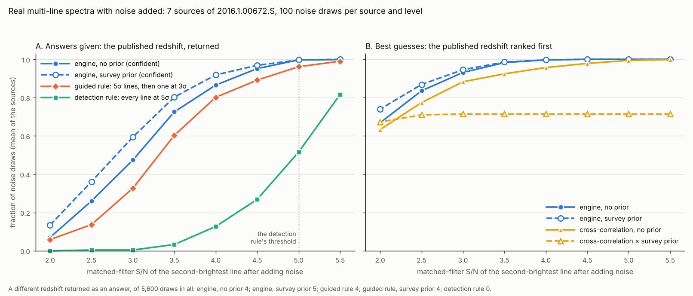
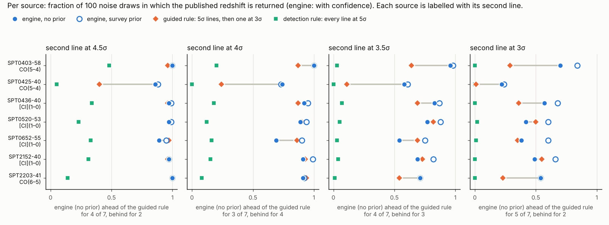

# Results

Every number here is produced by the code in `ladder_redshifts/` and stored under `results/`. Definitions are in
[`method.md`](method.md). An answer is **confident** if its confidence score is at least 0.95: that share of the
normalised likelihood × prior (called the posterior below, for brevity) lies within ±0.006 in ln(1+z) of the best
redshift. It is **correct** if it lies within 0.003 of the published value. The score is not a calibrated
probability; section 5 measures how reliable it is.

## 1. Real spectra: ALMA project 2016.1.00672.S, from pipeline-cube cut-outs

The sample is 21 SPT sources, each observed in 5 tunings × 4 spectral windows covering 84.1–114.8 GHz.

- **Extraction.** Cut-outs of ±20″ around the published positions; a point-source spectrum at the centre, with
  its noise put on the scale of its own line-free channels ([`method.md`](method.md), section 7).
- **Truth.** Reuter et al. 2020, Table E1.
- **Prior.** SPT-like redshift prior.

Per-source output is in `results/redshift_real_batch.csv`. There, `p_published` is the posterior mass on the
published z. "Flat sum" is the equal-weight sum of line S/N on the same spectra. "Rule" is the simplified Sudoku-style detection
rule, not the authors' code. Run with `python -m ladder_redshifts.batch_real`.

| Source | Lines in the published 3 mm scan | Engine z (confidence) | Published z | P(published) | Flat sum | Rule | Verdict |
|---|---|---|---|---|---|---|---|
| SPT0403-58 | CO(4–3) CO(5–4) \[CI\](1–0) | 4.056 (1.00) | 4.0564 | 1.00 | 4.056 (1.00) | 4.055 | confident & correct |
| SPT0425-40 | CO(5–4) CO(6–5) | 5.135 (1.00) | 5.1353 | 1.00 | 5.135 (1.00) | 5.134 | confident & correct |
| SPT0436-40 | CO(4–3) \[CI\](1–0) | 3.851 (1.00) | 3.8519 | 1.00 | 3.851 (1.00) | 3.851 | confident & correct |
| SPT0520-53 | CO(4–3) \[CI\](1–0) | 3.778 (1.00) | 3.7785 | 1.00 | 4.972 (0.66) ✗ | 3.778 | confident & correct |
| SPT0652-55 | CO(4–3) \[CI\](1–0) | 3.346 (1.00) | 3.3466 | 1.00 | 2.260 (0.91) ✗ | 3.345 | confident & correct |
| SPT2152-40 | CO(4–3) \[CI\](1–0) | 3.851 (1.00) | 3.8507 | 1.00 | 2.639 (0.91) ✗ | 3.851 | confident & correct |
| SPT2203-41 | CO(5–4) CO(6–5) | 5.194 (1.00) | 5.1937 | 1.00 | 5.194 (1.00) | 5.194 | confident & correct |
| SPT2232-61 | CO(3–2) | 2.893 (0.90) | 2.8936 | 0.90 | 2.893 (0.90) | — | ambiguous, best = published |
| SPT0314-44 | CO(3–2) | 2.933 (0.90) | 2.9345 | 0.90 | 2.933 (0.90) | — | ambiguous, best = published |
| SPT0402-45 | CO(3–2) | 2.683 (0.87) | 2.6833 | 0.87 | 2.683 (0.91) | — | ambiguous, best = published |
| SPT2349-52 | CO(4–3) | 3.900 (0.85) | 3.9000 | 0.85 | 2.675 (0.91) ✗ | — | ambiguous, best = published |
| SPT0226-45 | CO(4–3) | 3.233 (0.78) | 3.233 | 0.78 | 3.233 (0.78) | — | ambiguous, best = published |
| SPT2129-57 | CO(4–3) | 3.260 (0.77) | 3.2601 | 0.77 | 3.260 (0.77) | — | ambiguous, best = published |
| SPT0528-53 | CO(5–4) | 4.736 (0.76) | 4.737 | 0.76 | 2.442 (0.49) ✗ | — | ambiguous, best = published |
| SPT0054-41 | CO(5–4) | 4.876 (0.69) | 4.8769 | 0.69 | 4.876 (0.69) | — | ambiguous, best = published |
| SPT2031-51 | CO(3–2) | 2.452 (0.45) | 2.4521 | 0.45 | 2.452 (0.50) | — | ambiguous, best = published |
| SPT2311-45 | CO(3–2) | 2.507 (0.42) | 2.5073 | 0.42 | 2.507 (0.56) | — | ambiguous, best = published |
| SPT2316-50 | CO(4–3) | 4.178 (0.11) | 3.1413 | 0.02 | 4.178 (0.14) ✗ | — | ambiguous, best ≠ published |

- **All 7 sources with two or three lines: confident and correct.** The detection rule also settles all 7 on the
  same spectra; the equal-weight sum settles 4. For the other three, the equal-weight sum prefers a wrong redshift
  (0.66–0.91 of its weight): it reads CO(4–3) as CO(3–2) or CO(5–4) and treats the \[CI\](1–0) line as noise.
- **All 11 single-line sources: ambiguous.** None is above 0.90, and the published z is on top in 10. All eleven
  redshifts are confirmed by follow-up in other bands: ten in Reuter et al., and SPT0314-44, which that paper
  lists as tentative, by Riechers (2025) (section 4).
- **No confidently wrong answer** in 18 sources, or 19 with SPT0027-50 (section 3).
- **The stated confidence of the ambiguous answers is cautious.** Across the 11 ambiguous answers the mean stated
  confidence is 0.68, while the top candidate is the published z in 10 of 11; the average weight on the published z
  is 0.67. Eleven sources are far too few to calibrate the score.
- **The faintest second lines.** After the matched filter, SPT2203-41's CO(6–5) is at 5.6σ, SPT0520-53's
  \[CI\](1–0) at 6.5σ, SPT2152-40's \[CI\](1–0) at 7.1σ and SPT0652-55's \[CI\](1–0) at 7.4σ (3–5σ per channel
  at the peak). All are above the detection rule's 5σ threshold, so these spectra do not test the engine below it.
- **A feature outside the line list.** SPT0402-45 has a second feature at 96.26 GHz (6.4σ). It matches HCN(4–3)
  at the published redshift, which the engine does not model.
- **Sources without a published redshift.** SPT0433-59, SPT0549-56 and SPT2334-50 show no line above 5σ. The
  engine's confidence is 0.52, 0.05 and 0.27. For SPT0433-59, three features of 2–3σ fall where z = 4.394 puts
  CO(4–3), \[CI\](1–0) and CO(5–4); pure noise does this in about 5% of simulated Band 3 scans
  (`results/redshift_noise_only.json`).
- **With a flat redshift prior** (`batch_real --prior uniform`): the 7 multi-line sources are still all confident and
  correct. The published z is on top for 8 of the 11 single-line sources, at a maximum confidence of 0.66.
- **Changes from earlier versions.**
  - **First release to the pre-publication review (2 November).** The review fixed how overlapping windows are
    combined, how the equal-weight baseline is weighted, and how window edges enter the filter
    ([`development-notes.md`](development-notes.md), items 13–16). SPT2349-52 then ranked its published
    redshift first (it was 2.675 before).
  - **Second review (12 November).** The noise of these spectra was about 1.3 times too high, and the likelihood
    now allows each line a velocity offset (items 20–22). The engine's verdicts did not change. The detection
    rule now settles all 7 multi-line sources; with the old noise it settled 4, because three second lines sat
    just below its 5σ threshold.

## 2. The same project from ADMIT summaries (first pass)

These are pseudo-spectra built from the archive's ADMIT summaries, without downloading cubes. Windows with no
on-source spectrum are zero-filled (noise × 10). Outputs: `results/redshift_real_batch_admit.*` and
`figures/redshift_real_batch_admit.png`; run with `python -m ladder_redshifts.batch_real --admit`.

| Source | Lines in the published 3 mm scan | ADMIT windows on the source | Engine z (confidence) | Published z | P(published) | Verdict |
|---|---|---|---|---|---|---|
| SPT0436-40 | CO(4–3), \[CI\](1–0) | 3 | 3.851 (1.00) | 3.8519 | 1.00 | confident & correct |
| SPT0314-44 | CO(3–2) | 2 | 2.934 (0.88) | 2.9345 | 0.88 | ambiguous, best = published |
| SPT2232-61 | CO(3–2) | 1 | 2.893 (0.76) | 2.8936 | 0.76 | ambiguous, best = published |
| SPT2129-57 | CO(4–3) | 1 | 3.260 (0.71) | 3.2601 | 0.71 | ambiguous, best = published |
| SPT0402-45 | CO(3–2) | 1 | 2.683 (0.64) | 2.6833 | 0.64 | ambiguous, best = published |
| SPT0054-41 | CO(5–4) | 3 | 4.875 (0.55) | 4.8769 | 0.55 | ambiguous, best = published |
| SPT0652-55 | CO(4–3), \[CI\](1–0) | 1 | 3.347 (0.51) | 3.3466 | 0.51 | ambiguous, best = published |
| SPT2152-40 | CO(4–3), \[CI\](1–0) | 1 | 3.851 (0.38) | 3.8507 | 0.38 | ambiguous, best = published |
| SPT2031-51 | CO(3–2) | 2 | 2.452 (0.26) | 2.4521 | 0.26 | ambiguous, best = published |
| SPT0403-58 | CO(4–3), CO(5–4), \[CI\](1–0) | 2 | 2.792 (0.62) | 4.0564 | 0.02 | ambiguous, best ≠ published |
| SPT0520-53 | CO(4–3), \[CI\](1–0) | 2 | 4.972 (0.52) | 3.7785 | 0.11 | ambiguous, best ≠ published |
| SPT2311-45 | CO(3–2) | 2 | 3.677 (0.30) | 2.5073 | 0.18 | ambiguous, best ≠ published |
| 9 others | — | 0 | — | — | — | no spectrum on the source |

- **No confidently wrong answer.**
- **The three misses come from ADMIT.** SPT0403-58's CO(5–4) and SPT0520-53's \[CI\](1–0) fall in windows where
  ADMIT's spectra lie elsewhere in the field. SPT2311-45 had a single line.
- **The zero-filled windows do most of the work.** With the measured windows alone, the published z is the top
  candidate only for SPT0436-40.
- **The cube cut-outs (section 1) turned 1 confident answer into 7.**
- **Noise.** The ADMIT-route spectra already had their noise scaled to the line-free scatter of each window, so the
  noise correction of section 1 does not apply to them.

## 3. SPT0027-50, ALMA Band 2 science verification (project 2011.0.00025.SV)

The data are 20 spectral windows covering 76.9–111.0 GHz, with a 0.6″ beam. The spectrum comes from an aperture of
264 pixels: the continuum above 3σ, grown by half a beam, covering both lensed images. Output is in
`results/redshift_real_SPT0027.json`; run with `python -m ladder_redshifts.realspec`.

**Detections** above 5σ (matched filter): 77.826 GHz (S/N 24.7), 103.760 GHz (35.1), 110.768 GHz (11.9).

**Estimators:**

| Estimator | z | Note |
|---|---|---|
| SLED likelihood | 3.4432 | confidence 1.000; published 3.444 |
| Equal-weight sum | 3.4432 | same as above |
| Detection rule | 3.4433 | unique solution |
| Naive spacing | 15.65 | wrong; fooled by [CI] |

**More noise** (30 draws per level):

| Noise | Confident & correct | Confidently wrong |
|---|---|---|
| ×1–4 | every time | — |
| ×6 | 93% | 0% |
| ×8 | 73% | 0% |

**Less coverage:**

| Coverage kept | Result |
|---|---|
| ≥ 84.2 GHz (Band 3-like) | correct, confidence 1.000 |
| CO(3–2) alone | ambiguous: 0.50 at the true z vs 0.34 at z = 5.32 |
| CO(4–3) alone | ambiguous, with the true z third at 0.25 |

The S/N values are about 1.7 times those of the first release, whose noise for this aperture spectrum was too high
by that factor ([`development-notes.md`](development-notes.md), item 20). The added-noise test starts from the
corrected noise, so each level is a fainter source than before.

## 4. Follow-up planner on a real single-line source: SPT0314-44

`python -m ladder_redshifts.followup` uses the cube cut-out spectrum. Here the line straddles the edge between two
tunings.

- **Detection.** One line at 87.922 GHz, matched-filter S/N 52.
- **Engine.** With the SPT-like prior: z = 2.9332 (CO(3–2)) at 0.897 and z = 1.6222 (CO(2–1)) at 0.103. That is
  ambiguous, with the best candidate equal to the published identification, z = 2.9345, which was tentative when
  published and has been confirmed since (end of this section). With a flat prior the split is 0.60 / 0.40.
- **Planner settings.** One tuning of 2 × 3.75 GHz in Bands 3–7, with the sidebands where each receiver's IF range
  puts them ([`method.md`](method.md), section 8), LO in 1 GHz steps, 10 noise draws. Candidates with at least 1%
  posterior are included, weighted by it.
- **Shared lines do not count.** The two candidates share every third harmonic of the detected line: 175.8, 263.7
  and 351.4 GHz (for example CO(9–8) at z = 2.933 and CO(6–5) at z = 1.622). A tuning that adds only such a
  line cannot settle the redshift and scores 0 ([`method.md`](method.md), section 8).

LO settings that reach P(confident & correct) ≥ 0.9:

| Condition | Band 4 (23 LOs) | Band 5 (38) | Band 6 (45) | Band 7 (83) | Total |
|---|---|---|---|---|---|
| Same noise per channel as the scan, low excitation | 11 | 12 | 7 | 19 | 49 |
| 3× noisier (≈ 1/9 of the time), low excitation | 11 | 12 | 7 | 10 | 40 |
| Same noise, typical excitation | 11 | 12 | 7 | 19 | 49 |

Band 3 is already covered, apart from 1 GHz at its top edge that holds no line of either candidate. Of the 190 LO
settings in all, 52 cover a line that only one candidate predicts. At the scan's noise level 49 of them settle the
redshift whichever candidate is true. The other three catch such a line only at the very edge of a window; they
settle it if z = 2.933 is right and not otherwise (P = 0.90). The remaining 138 score 0.

The best choice is Band 4 with the LO at 139 GHz. CO(3–2) at 131.9 GHz (if z = 1.622) falls in the lower sideband
and CO(5–4) at 146.5 GHz (if z = 2.933) in the upper one, so either outcome is a detection. LOs of 136–138 GHz
cover only the first of these and 140–142 GHz only the second; the planner still scores them at 1, because a line
that bright cannot be missed if it is there. All eleven Band 4 settings survive noise three times higher.

**What settled it in the end.** Riechers (2025, ApJ 980, 59) observed SPT0314-44 with the ACA in Band 6, with the
sidebands centred near 249 and 263 GHz, and found CO(9–8) together with H₂O emission and OH⁺ and NH absorption,
giving z = 2.9338 ± 0.0002. The engine's best candidate from the single Band 3 line, 2.9332, is 46 km/s from
that. The planner would not have picked this tuning: of those lines it knows only CO(9–8), which is the harmonic
the two candidates share, so it scores the LO settings near 256 GHz at 0. The redshift was decided by species
outside the engine's line list. For bright lensed sources the planner is therefore conservative: tunings that
work through H₂O or OH⁺ are invisible to it, and so is their evidence to the engine itself.

## 5. Synthetic atlas (2,500 sources × 6 setups)

`python -m ladder_redshifts.atlas`. S/N is the CO(4–3)-equivalent. The population is described in
[`method.md`](method.md), section 9. Its parameters are illustrative, and its random seed was first used after the
last change to the likelihood. The simulated lines have no velocity offsets between them. The table gives the
fraction with a confident, correct redshift at S/N 8–16, with the fraction confidently wrong in brackets.
"Equal-weight sum" and "Sudoku-style rule" are the simplified baselines of `method.md`, section 4.

| Setup | Naive spacing | Sudoku-style rule | Equal-weight sum | SLED likelihood | SLED + photo-z |
|---|---|---|---|---|---|
| Band 3 single tuning | 0.01 (3.6%) | 0.04 (0%) | 0.03 (0%) | 0.05 (0%) | 0.05 (0%) |
| Band 3 scan (84–115 GHz) | 0.16 (33%) | 0.48 (0%) | 0.46 (0%) | 0.51 (0%) | 0.59 (0.7%) |
| Band 4 scan (125–163 GHz) | 0.31 (30%) | 0.59 (0%) | 0.59 (0.2%) | 0.65 (0.2%) | 0.69 (0.2%) |
| Band 2 full, WSU (67–116 GHz) | 0.18 (47%) | 0.63 (0%) | 0.70 (2.2%) | 0.72 (0.2%) | 0.80 (0.4%) |
| Band 3 + Band 4 scans | 0.30 (55%) | 0.79 (0.4%) | 0.87 (5.8%) | 0.90 (0%) | 0.94 (0%) |
| Band 2 + Band 4 | 0.23 (64%) | 0.81 (0%) | 0.93 (2.4%) | 0.94 (0.2%) | 0.96 (0.2%) |

- **Low S/N.** At S/N 2–4 the SLED likelihood gives 3.3–5.8× more confident, correct redshifts than the detection
  rule in the five multi-tuning setups. At S/N 4–8 it gives 1.3–1.5× more. In every S/N bin it is confidently wrong
  in at most 0.8% of the scan sources (`results/redshift_atlas.json`, `by_rho`).
- **The equal-weight sum in wide setups.** It is confidently wrong in up to 2.7% (Band 2) and 6.4% (Band 3 + Band 4)
  of the sources in an S/N bin.
- **Naive spacing.** It fails because \[CI\] lines sit between CO rungs.

**How reliable is a confident answer?** This counts all S/N together (`reliability` in the JSON):

| Setup | SLED: answers ≥ 0.95 | of which correct | mean stated confidence | Equal-weight sum: of ≥ 0.95, correct |
|---|---|---|---|---|
| Band 3 single tuning | 93 | 97.8% (2 wrong) | 0.998 | 97.1% (70) |
| Band 3 scan | 1236 | 99.8% (3 wrong) | 0.999 | 99.4% (1136) |
| Band 4 scan | 1530 | 99.4% (9 wrong) | 0.999 | 99.4% (1436) |
| Band 2 full, WSU | 1750 | 99.7% (6 wrong) | 0.999 | 97.0% (1738) |
| Band 3 + Band 4 scans | 2122 | 99.6% (8 wrong) | 0.999 | 95.3% (2152) |
| Band 2 + Band 4 | 2208 | 99.9% (3 wrong) | 1.000 | 98.0% (2226) |

- **Scans.** A confident answer from the SLED likelihood is right in 99.4–99.9% of cases. That is below the stated
  mean of about 0.999, so the score is overconfident in the tail.
- **A single Band 3 tuning.** 2 of 93 confident answers are wrong: one CO line read as another rung, and one
  CO/\[CI\] confusion.
- **The price of the velocity tolerance.** The simulated lines have no velocity offsets, which is the case where
  exact line positions help most. On the same 2,500 sources, exact positions give 20 wrong answers among 8,931
  confident ones (all six setups together); the tolerance gives 31 among 8,939. Several of the wrong ones are
  off by a factor of 2 or 3 in the rung: readings that predict the same covered lines are separated only by line
  ratios and the prior ([`development-notes.md`](development-notes.md), "Known open issues").
- **Reading the score.** Treat it as a ranking with a conservative threshold in multi-tuning scans, not as a
  probability.
- **Earlier populations.** With seed 7, before the fixes of items 15–16, there were 7 wrong answers among 101
  single-tuning answers ≥ 0.99. With seed 20261102 and exact line positions (the release of 2 November), confident
  answers were right in 99.7–100% of cases in scans and in 101 of 104 for a single tuning.

## 6. Known octave traps, rebuilt from their published coverage

`python -m ladder_redshifts.traps`. Each source is rebuilt with 150 noise draws per variant (excitation or line
strength), using the adopted (robust) [CI] prior. Line strengths are illustrative where the papers do not give them.

| Trap | Before the decisive data | After |
|---|---|---|
| HerBS-108 (3 mm + 2 mm scans; z = 3.717 vs 1.358) | Weak-[CI] variants: flagged ambiguous in 49–95% of draws and never confidently wrong. With typical [CI] it is already settled. | + extra 3 mm setup (CO(3–2) at 73.3 GHz): confident & correct in 99–100% |
| SPT0551-50 (one Band 3 line; z = 3.164 vs 2.123) | Ambiguous in 97–100%, confidently wrong in at most 3.3%. Still ambiguous after adding the 1 mm window (96–100%; confidently wrong in at most 3.3%). | + [CII] window: confident & correct in 100% |
| SPT0452-50 (ATCA + Band 3 with CO(5–4) flagged; z = 5.016 vs 2.011) | Confident & correct in 0–43%, otherwise ambiguous; never confidently wrong | + empty [CI] windows: 83–91%; + re-reduced CO(5–4): 99–100%; + [CII]: 100% |

With the first, narrower [CI] prior (no weak-[CI] template), HerBS-108-like data are confidently wrong in up to a
quarter of draws; both versions are in `results/redshift_traps.json`.

The single faint line of SPT0551-50 (S/N 6) is where the velocity tolerance costs most: with exact line positions
the confidently wrong fraction was at most 0.7% before the 1 mm window and 2% after it.

## 7. Tuning optimiser for ALMA Band 2

`python -m ladder_redshifts.tuning`. The population has SPT-like redshifts.

- **How layouts are chosen.** Tunings are placed greedily on a 1 GHz grid, using one simulated population of 200
  sources.
- **How they are scored.** The chosen layouts are then scored on an independent population of 200 (a new seed), and
  those held-out fractions are the ones below. Values are uncertain by about ±0.035, and the fractions measured on
  the selection population are up to 0.08 higher.

The table gives the fraction of confident, correct redshifts:

| Strategy | Bright, same depth per tuning | Bright, fixed total time | Faint, same depth | Faint, fixed total time |
|---|---|---|---|---|
| Band 2 now, 1 tuning (best block starts at 82 GHz) | 0.06 | 0.06 | 0.04 | 0.04 |
| Band 2 now, 2 tunings | 0.21 | 0.21 | 0.18 | 0.14 |
| Band 2 now, 4 tunings | 0.68 | 0.56 | 0.51 | 0.18 |
| Band 2 now, 5 tunings (greedy) | 0.76 | — | 0.63 | — |
| Band 2 now, 5 contiguous (science-verification layout) | 0.77 | 0.65 | 0.64 | 0.16 |
| Band 2 now, full band (7 tunings) | 0.86 | 0.74 | 0.77 | 0.13 |
| Band 2 + WSU, 1 tuning | 0.66 | 0.66 | 0.61 | 0.61 |
| Band 2 + WSU, 2 tunings | 0.85 | 0.82 | 0.71 | 0.59 |
| Band 3 standard 5-tuning scan | 0.68 | 0.56 | 0.54 | 0.11 |

"Bright" means CO(4–3) at S/N 12 per tuning, and "faint" means S/N 5. Under fixed total time, per-line S/N falls as
1/√N. The receiver models follow C. De Breuck, "ALMA Band 2 as a redshift machine" (ESO, February 2026).

Greedy Band 3 layouts of one to four tunings, with the sidebands 4.125–7.875 GHz from the LO, are in
`results/redshift_tuning.json` and in the figure. Four tunings reach 0.49 for bright sources and 0.43 for faint
ones, below the five contiguous tunings of the standard scan.

Bakx (2026) asks the same question for Band 3 and for Band 2 with 8 and 14 GHz of bandwidth, using the High-z
Sudoku tool, which counts the lines a layout covers at each redshift. This optimiser scores simulated spectra at a
set S/N, and its receiver models differ. The two sets of answers have not been compared.

## 8. The High-z Sudoku code on the same sources and setups

`python scripts/compare_sudoku.py /path/to/RSG.py` runs the public code of Bakx & Dannerbauer (2022),
[tjlcbakx/redshift-search-graphs](https://github.com/tjlcbakx/redshift-search-graphs) (commit `e60dd15`, 8 April
2022), unmodified, and writes `results/redshift_sudoku_comparison.json`. That code is not redistributed here.

- **What that code does.** Its function `RSGquality` takes frequency windows and redshifts, not a spectrum. For each
  redshift it counts the lines that fall inside the windows and classes the redshift as no line, one line, two
  lines, or three or more.
  - **One line** is robust when a photometric redshift good to Δz/(1+z) = 0.13 excludes the neighbouring CO
    identifications at 5σ, or when those would have shown more than one line.
  - **Two lines** are robust unless a neighbouring solution would also show exactly two CO lines.
  - **Depth.** Every covered line counts as detected, whatever its strength.
- **CO only, or with \[CI\].** The line list holds CO and the far-infrared fine-structure lines. \[CI\] is optional,
  and the authors advise counting it only for deep surveys. Both versions are given.

### The 19 real sources

Each source is classed at its published redshift, with the windows of its own spectrum. The engine's verdicts are
those of sections 1 and 3.

| Source | Lines seen in the scan | Sudoku, CO only | Sudoku, with \[CI\] | Engine (confidence) |
|---|---|---|---|---|
| SPT0027-50 | 3 | two lines, robust | three or more lines | confident & correct (1.00) |
| SPT0403-58 | 3 | two lines, robust | three or more lines | confident & correct (1.00) |
| SPT0425-40 | 2 | two lines, robust | two lines, robust | confident & correct (1.00) |
| SPT0436-40 | 2 | one line, not robust | two lines, robust | confident & correct (1.00) |
| SPT0520-53 | 2 | one line, not robust | two lines, robust | confident & correct (1.00) |
| SPT0652-55 | 2 | one line, not robust | two lines, robust | confident & correct (1.00) |
| SPT2152-40 | 2 | one line, not robust | two lines, robust | confident & correct (1.00) |
| SPT2203-41 | 2 | two lines, robust | two lines, robust | confident & correct (1.00) |
| SPT2232-61 | 1 | one line, robust with photo-z | one line, robust with photo-z | ambiguous, best = published (0.90) |
| SPT0314-44 | 1 | one line, robust with photo-z | one line, robust with photo-z | ambiguous, best = published (0.90) |
| SPT0402-45 | 1 | one line, robust with photo-z | one line, robust with photo-z | ambiguous, best = published (0.87) |
| SPT2349-52 | 1 | one line, not robust | two lines, robust | ambiguous, best = published (0.85) |
| SPT0226-45 | 1 | one line, not robust | one line, not robust | ambiguous, best = published (0.78) |
| SPT2129-57 | 1 | one line, not robust | one line, not robust | ambiguous, best = published (0.77) |
| SPT0528-53 | 1 | one line, not robust | two lines, robust | ambiguous, best = published (0.76) |
| SPT0054-41 | 1 | one line, not robust | one line, not robust | ambiguous, best = published (0.69) |
| SPT2031-51 | 1 | one line, not robust | one line, robust with photo-z | ambiguous, best = published (0.45) |
| SPT2311-45 | 1 | one line, not robust | one line, robust with photo-z | ambiguous, best = published (0.42) |
| SPT2316-50 | 1 | one line, not robust | one line, not robust | ambiguous, best ≠ published (0.11) |

- **Multi-line sources (the first eight rows).** With \[CI\] counted, Sudoku classes all eight as robust, and the
  engine is confident and correct for all eight. With CO alone it classes the four CO(4–3) + \[CI\](1–0) sources
  as one line, not robust, because their second line is the \[CI\] line.
- **Single-line sources (11).** The engine leaves all eleven open. Sudoku's classes for them fall in three groups:
  - **Five are robust given a photometric redshift** (three of them with CO alone). The engine was run here with
    the survey's redshift distribution as its only prior, not with each source's photometric redshift, so the
    two are answering different questions. The engine's three highest single-line confidences (0.90, 0.90, 0.87)
    belong to the three sources that Sudoku classes this way with CO alone.
  - **Two are "two lines, robust" once \[CI\] is counted** (SPT2349-52 and SPT0528-53): \[CI\](1–0) lies inside the
    scan. The published scan shows one line in each. The class describes the coverage, not the depth that was
    reached. The engine, which weighs the missing \[CI\] line against how faint it may be, gives 0.85 and 0.76.
  - **Four are not robust** in either version.
- **No contradiction.** Every source the engine settles is one that Sudoku classes as robust with \[CI\]. The seven
  sources that Sudoku classes as robust and the engine leaves open are the seven above, for the reasons given.

### The synthetic atlas

The six setups of section 5, for the 1,040 of the atlas's 2,500 sources with CO(4–3) at S/N ≥ 16. These are the
sources for which the engine comes closest to the unlimited depth that the Sudoku classes assume.

| Setup | Sudoku robust, CO only | Sudoku robust, with \[CI\] | Engine | Engine + photo-z | Stand-in rule | Sudoku, two or more lines, with \[CI\] |
|---|---|---|---|---|---|---|
| B3 single tuning | 0.007 | 0.121 | 0.051 | 0.056 | 0.046 | 0.048 |
| B3 scan | 0.550 | 0.835 | 0.606 | 0.698 | 0.596 | 0.593 |
| B4 scan (2 mm) | 0.724 | 0.835 | 0.726 | 0.770 | 0.720 | 0.728 |
| B2 full (WSU) | 1.000 | 1.000 | 0.839 | 0.895 | 0.815 | 0.756 |
| B3 + B4 scans | 0.958 | 0.989 | 0.964 | 0.978 | 0.956 | 0.939 |
| B2 + B4 | 0.981 | 0.981 | 0.996 | 0.999 | 0.977 | 0.950 |

"Sudoku robust" is the authors' robust redshift coverage: two or more lines unless degenerate, plus robust single
lines. "Engine" is the fraction of confident, correct answers. The last column is Sudoku's fraction with two or
more lines and no degeneracy, with \[CI\] counted; that is the class the stand-in rule of this repository was
written to imitate.

- **The stand-in rule tracks the class it imitates** to within 0.02 in four setups. In the two Band 2 setups it is
  higher (0.815 against 0.756, and 0.977 against 0.950).
- **In the Band 3 and Band 4 scans the engine lies between Sudoku's two figures.** For the Band 3 scan it reaches
  0.606, or 0.698 with a photometric redshift, against 0.550 (CO only) and 0.835 (with \[CI\]).
- **For the full Band 2 it is below both** (0.839, or 0.895 with a photometric redshift, against 1.000).
- **Why the engine falls short of the higher figure.** The Sudoku figures assume that every covered line is seen;
  at finite depth the engine has to allow that a predicted line is too faint. The atlas's photometric redshifts
  are also poorer (0.20 in ln(1+z)) than the 0.13 Sudoku assumes, though that matters less: with 0.20 the Band 3
  figure with \[CI\] is 0.811.
- **In the two-band setups they agree** to within 0.03.

### What this comparison is not

The Sudoku code reads no spectrum and has no notion of signal-to-noise, so there are no error rates to set side by
side. Its graphical tool (`RSGplot`), read by eye for each source, is not reproduced here; the stand-in rule
remains this repository's substitute for that reading.

## 9. The multi-line spectra with noise added

`python -m ladder_redshifts.degrade`. As observed, the seven multi-line sources of section 1 have their
second-brightest line at 5.6σ or more, so a rule that needs every line at 5σ settles all of them, and the real
data do not test the engine where it should gain. Here Gaussian noise is added to each real spectrum until that
line would sit at a chosen S/N, and each method is run on 100 noise draws per source and level.

Outputs: `results/redshift_degradation.json`, `figures/redshift_degradation.png` (means) and
`figures/redshift_degradation_sources.png` (per source).

### The methods

- **This engine,** with no redshift prior and with the survey prior of section 1.
- **Detection rule.** The stand-in rule of the other sections: every line at 5σ, and a single surviving solution.
- **Guided rule.** The 5σ lines first. If they leave several solutions, one further line at 3σ (or 4σ) is accepted
  within 150 km/s of a position a surviving solution predicts, and the rule answers when exactly one solution is
  confirmed this way. It stands for what an observer does by eye. Given the survey prior, it also answers when
  one remaining solution holds at least 0.95 of the prior weight.
- **Template cross-correlation,** re-implemented from the description in Yun et al. (2015, appendix A): the
  spectrum is cross-correlated with a template of all the lines, each weighted by its relative strength, and the
  S/N at each trial redshift is set by shuffling the spectrum. The best guess is the redshift with the highest
  S/N, or with the highest S/N × p(z) when a prior is given.
- **Equal-weight sum.** As in section 1.

Two kinds of outcome are kept apart. The engine, when confident, and the two rules either give an answer or give
none, so they are compared on the answers they give. The cross-correlation always has a best redshift, so it is
compared with the engine's best guess.

### Like for like: no redshift prior

The two rules and the cross-correlation use only the spectrum. Without a prior the engine does too, so this is
the comparison in which every method has the same information.

**Answers given.** Fraction of draws in which the published redshift is returned (for the engine and the
equal-weight sum, with confidence):

| S/N of the second line | Engine, no prior | Guided rule, 3σ | Guided rule, 4σ | Detection rule, 5σ | Equal-weight sum, no prior |
|---|---|---|---|---|---|
| 5.5 | 1.00 | 0.99 | 0.97 | 0.82 | 0.55 |
| 5 | 1.00 | 0.96 | 0.92 | 0.52 | 0.55 |
| 4.5 | 0.95 | 0.89 | 0.72 | 0.27 | 0.53 |
| 4 | 0.87 | 0.80 | 0.47 | 0.13 | 0.48 |
| 3.5 | 0.73 | 0.60 | 0.28 | 0.03 | 0.42 |
| 3 | 0.47 | 0.33 | 0.09 | 0.00 | 0.30 |
| 2.5 | 0.26 | 0.14 | 0.03 | 0.00 | 0.18 |
| 2 | 0.07 | 0.06 | 0.00 | 0.00 | 0.06 |

- **The engine gives somewhat more answers than the guided rule.** With the second line at 4σ it returns the
  published redshift in 0.87 of the draws against 0.80 for the guided rule at 3σ; at 3.5σ, 0.73 against 0.60; at
  3σ, 0.47 against 0.33.
- **The gain is uneven across sources.** At 4σ the engine is ahead for three of the seven sources and behind for
  four; at 3.5σ, ahead for four and behind for three; at 3σ, ahead for five and behind for two.
  - **Where it gains.** SPT0403-58, SPT0425-40 and SPT0436-40 at 4σ, 3.5σ and 3σ, and SPT2203-41 at 3.5σ and 3σ.
    SPT0425-40 accounts for much of the mean: its two lines are equally bright and sink together. Without it the
    engine and the rule stand at 0.89 and 0.90 at 4σ, at 0.75 and 0.69 at 3.5σ, and at 0.52 and 0.38 at 3σ.
  - **Where it does not.** For the three sources whose second line is a faint \[CI\] line (SPT0520-53,
    SPT0652-55, SPT2152-40) the guided rule does as well or better at 4σ and at 3.5σ.
- **Wrong answers are equally rare.** Of the 5,600 draws, the engine returned a different redshift with
  confidence in 4 and the guided rule at 3σ returned one in 4. The guided rule at 4σ and the 5σ rule never did.
- **The 5σ rule stops answering below its threshold,** as it must: 0.13 at 4σ and 0.03 at 3.5σ.
- **The equal-weight sum never passes 0.55.** It fails on the same three sources as in section 1.

| Source | Second line (S/N as observed) | Engine, no prior, at 4σ / 3.5σ / 3σ | Guided rule (3σ) at 4σ / 3.5σ / 3σ | Cross-correlation best guess, no prior |
|---|---|---|---|---|
| SPT0403-58 | CO(5–4) (9.8) | 1.00 / 0.96 / 0.70 | 0.87 / 0.64 / 0.29 | 0.96 / 0.91 / 0.88 |
| SPT0425-40 | CO(5–4) (10.9) | 0.74 / 0.58 / 0.22 | 0.24 / 0.11 / 0.01 | 0.98 / 0.93 / 0.76 |
| SPT0436-40 | \[CI\](1–0) (15.2) | 0.92 / 0.83 / 0.57 | 0.87 / 0.69 / 0.36 | 1.00 / 0.99 / 0.98 |
| SPT0520-53 | \[CI\](1–0) (6.5) | 0.89 / 0.77 / 0.42 | 0.90 / 0.82 / 0.50 | 0.98 / 0.97 / 0.92 |
| SPT0652-55 | \[CI\](1–0) (7.4) | 0.69 / 0.54 / 0.38 | 0.86 / 0.69 / 0.35 | 0.86 / 0.84 / 0.76 |
| SPT2152-40 | \[CI\](1–0) (7.1) | 0.91 / 0.69 / 0.49 | 0.93 / 0.73 / 0.55 | 1.00 / 0.99 / 1.00 |
| SPT2203-41 | CO(6–5) (5.6) | 0.91 / 0.71 / 0.54 | 0.94 / 0.54 / 0.23 | 0.92 / 0.84 / 0.88 |

**Best guesses.** Fraction of draws in which the published redshift is ranked first:

| S/N of the second line | Engine, no prior | Cross-correlation, no prior | Engine, survey prior | Cross-correlation × survey prior |
|---|---|---|---|---|
| 5.5 | 1.00 | 1.00 | 1.00 | 0.71 |
| 5 | 1.00 | 0.99 | 1.00 | 0.71 |
| 4.5 | 1.00 | 0.98 | 1.00 | 0.71 |
| 4 | 1.00 | 0.96 | 1.00 | 0.71 |
| 3.5 | 0.98 | 0.92 | 0.99 | 0.71 |
| 3 | 0.93 | 0.88 | 0.95 | 0.71 |
| 2.5 | 0.84 | 0.77 | 0.87 | 0.71 |
| 2 | 0.67 | 0.63 | 0.74 | 0.67 |

- **The engine's best guess is right slightly more often than the cross-correlation's.** With no prior the two
  stand at 1.00 and 0.96 at 4σ, 0.98 and 0.92 at 3.5σ, and 0.93 and 0.88 at 3σ. From 4.5σ to 3.5σ the engine is
  never behind for any source; at 3σ it is ahead for four sources and behind for three.
- **Where the difference comes from.** It is largest for SPT0652-55 (1.00 against 0.86 at 4σ) and SPT2203-41
  (1.00 against 0.92). The cross-correlation has one fixed set of line ratios. When the second line is weaker
  than that template expects, reading the bright line alone at another redshift scores as high as the true
  two-line reading. The engine's template bank allows the weaker ratio.

### With the survey prior

| S/N of the second line | Engine, survey prior | Guided rule (3σ) with the survey prior | Guided rule (3σ), no prior |
|---|---|---|---|
| 5.5 | 1.00 | 0.99 | 0.99 |
| 5 | 1.00 | 0.96 | 0.96 |
| 4.5 | 0.97 | 0.89 | 0.89 |
| 4 | 0.92 | 0.80 | 0.80 |
| 3.5 | 0.80 | 0.60 | 0.60 |
| 3 | 0.59 | 0.33 | 0.33 |
| 2.5 | 0.36 | 0.14 | 0.14 |
| 2 | 0.13 | 0.06 | 0.06 |

- **The engine gains from the prior: 0.92 at 4σ, 0.80 at 3.5σ and 0.59 at 3σ.** It returned a different redshift
  with confidence in 5 of the 5,600 draws.
- **The guided rule does not.** Given the same prior, its figures change by 0.002 at most. A broad survey prior
  almost never puts 0.95 of its weight on one of the remaining solutions, and a prior cannot turn a missing line
  into a detection. With the prior for both, the engine is ahead for six of seven sources at 4σ and for all
  seven at 3.5σ and 3σ. A rule built to use the prior in some other way might do better.
- **The cross-correlation × prior fails for the two sources at z > 5.** From 5.5σ down to 2.5σ it ranks the
  published redshift first in 0.71 of the draws: always for five sources, never for SPT0425-40 and SPT2203-41.
  The product of the S/N with a prior centred on z = 3.9 outweighs a second line, even with no noise added.
  - **This is not the paper's procedure.** Yun et al. multiply by the probability of each source's own
    photometric redshift. This repository has no photometric redshifts, so the survey prior stands in, and the
    column tests the product rule with a population prior.

### The same methods on the 19 real spectra, as observed

| | Engine, no prior | Engine, survey prior | Guided rule (3σ) | Cross-correlation, no prior | Cross-correlation × survey prior |
|---|---|---|---|---|---|
| Answers given: correct / wrong | 8 / 0 | 8 / 0 | 8 / 0 | — | — |
| Best guess right, 8 multi-line sources | 8 | 8 | — | 8 | 6 |
| Best guess right, 11 single-line sources | 8 | 10 | — | 3 | 5 |

- **On answers, a tie.** The engine and the guided rule both settle the eight multi-line sources (the seven above
  and SPT0027-50) and leave the eleven single-line sources open. The prior changes nothing for the rule.
- **The cross-correlation gets all eight multi-line sources right without a prior.**
- **Its 3 of 11 on single-line sources is not a score.** With one line, every reading of that line alone has the
  same S/N in the cross-correlation, so its choice among them is arbitrary. The statistic cannot rank one-line
  readings; the engine ranks them by what else each reading predicts inside the scan.

### Limits of this test

- **The draws are not independent.** Each one keeps the noise of the real spectrum and adds to it. At the first
  levels little is added (for SPT2203-41 at 5.5σ the noise rises by 2%), so those draws mostly repeat the observed
  spectrum.
- **Seven sources, and the ones the engine was developed on.** The test uses real line shapes, line ratios and
  window layouts, but it is not an independent sample.
- **The comparison methods are this repository's.** The guided rule is our construction. The cross-correlation is
  our re-implementation and differs from the paper in three stated ways:
  - **Weights.** The paper takes them from a composite spectrum of SPT galaxies and gives no numbers. Here they
    are this package's line-ratio template fitted to the composite luminosities of Spilker et al. (2014,
    Table 2).
  - **Line width.** The paper gives none. The template lines here have the 450 km/s detection profile.
  - **Noise.** The spectrum is divided by its noise first, which helps on scans whose noise differs between
    windows. The S/N uses the closed-form limit of the paper's 10,000 shuffles; a test checks it against real
    shuffles.
- **An observer has more to go on** than either rule: line widths, the continuum and a photometric redshift.
